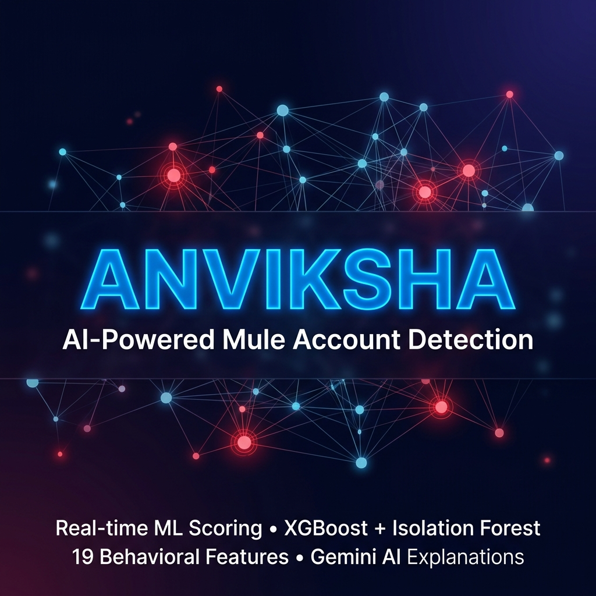
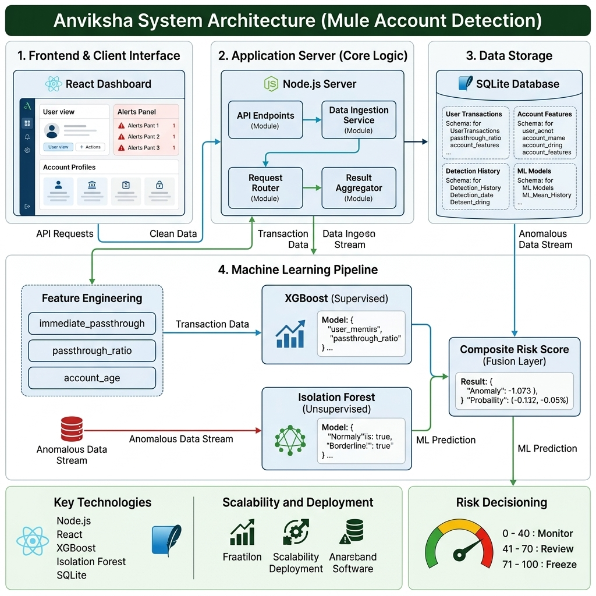
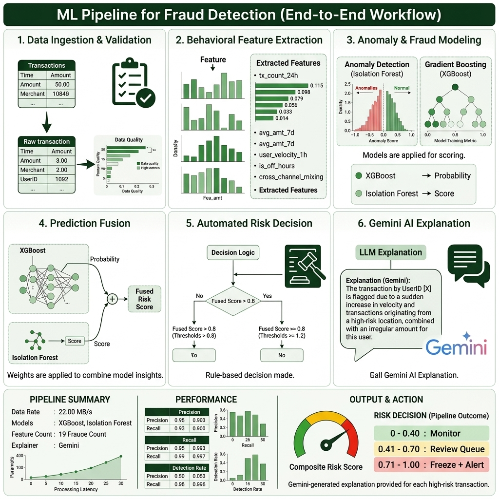
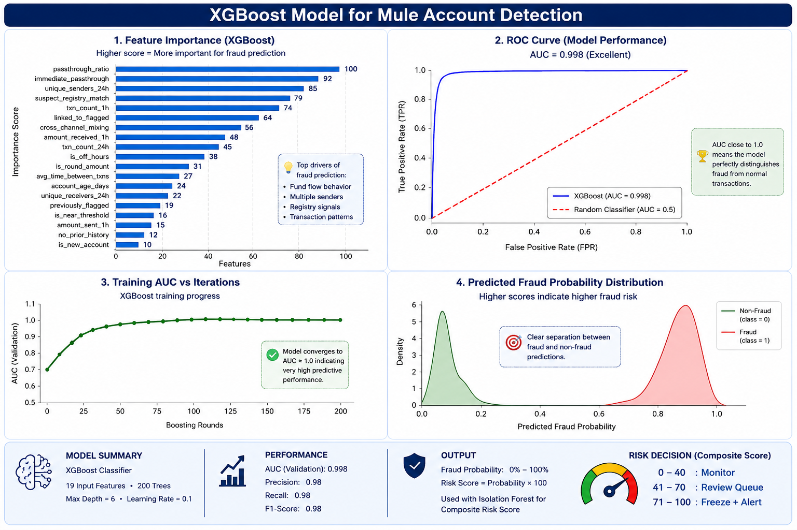
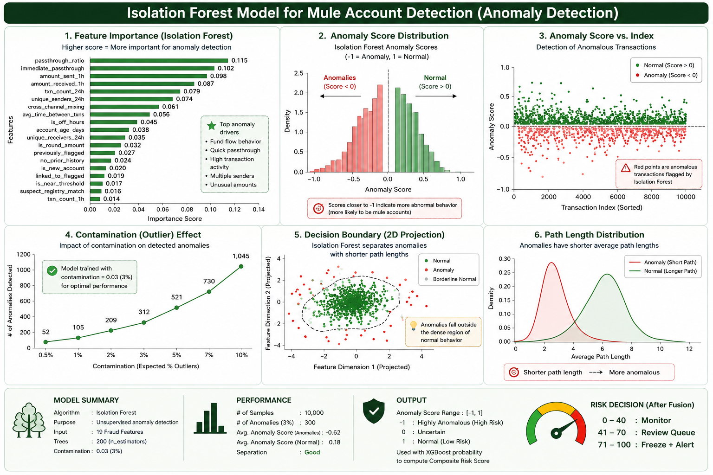
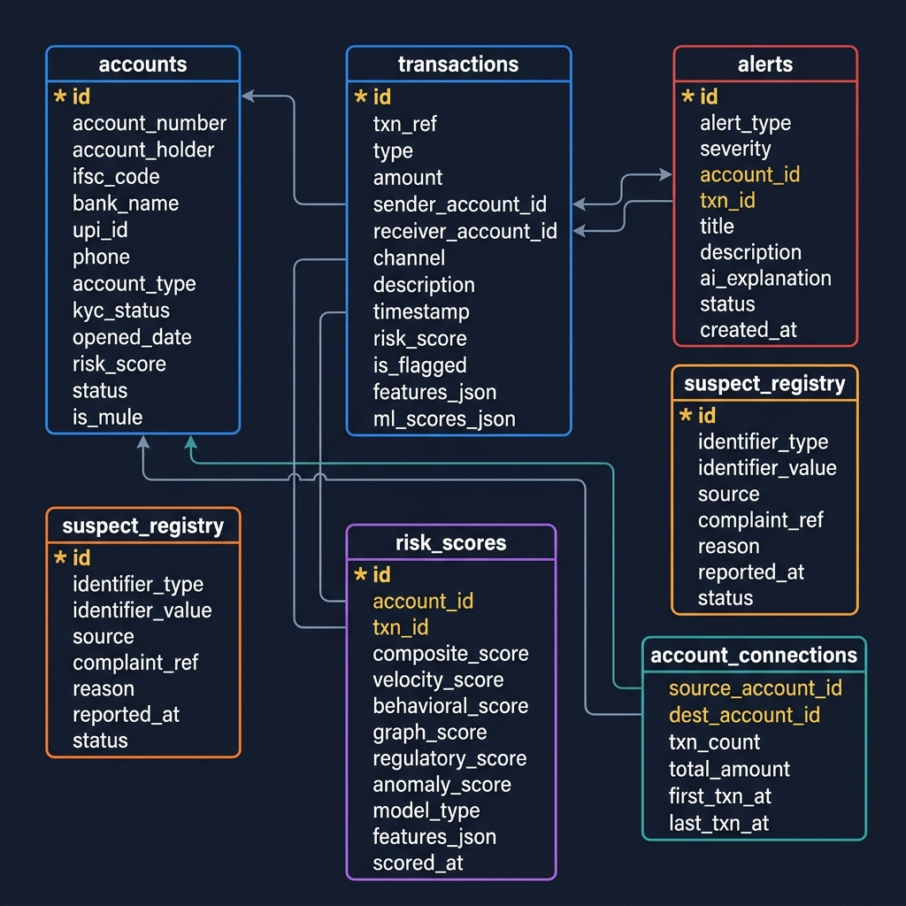

<div align="center">



# Anviksha — AI-Powered Mule Account Detection

**Real-time fraud detection system for the Bank of India Hackathon 2026**

[](https://nodejs.org/)
[](https://go.dev/)
[](https://redpanda.com/)
[](https://docker.com/)
[](https://react.dev/)
[](https://python.org/)
[](https://xgboost.readthedocs.io/)
[](https://onnxruntime.ai/)
[](https://sqlite.org/)
[](https://ai.google.dev/)

</div>

---

## 🎯 What is Anviksha?

**Anviksha** (Sanskrit: "analytical investigation") detects **mule accounts** — bank accounts used as financial intermediaries to launder fraud proceeds — in real time.

It ingests a live stream of UPI, NEFT, IMPS, and ATM transactions, extracts **18 golden abstract features** plus **4 domain-engineered discriminative features** directly from the Bank of India dataset (9,082 accounts, 81 mules), runs them through a **Two-Stage Cascade (XGBoost + Isolation Forest)** exported to ONNX (achieving **0.86 ROC-AUC and 91.3% high-confidence precision under leakage-free 5-fold cross-validation**), and uses the **Gemini API** to generate FIU-IND compliant STR reports and natural-language case summaries for flagged accounts.

> 🏆 Built for the **Bank of India Hackathon 2026** — Problem 2: Mule Account / Fraud Detection

---


---

## 🏗️ System Architecture



The system is structured as an event-driven microservices architecture:
- **`ingestion-service/`** — Go microservice serving as a Layer 1 Shield (JA3 Fingerprinting)
- **`Redpanda (Kafka)`** — High-throughput event broker for transaction streaming
- **`/server`** — Node.js backend acting as a Kafka consumer, ML inference engine, and WebSocket server
- **`/client`** — React + Vite frontend dashboard

---

## 🤖 ML Pipeline



### Model Performance Insights




### How it works

Every transaction goes through a 7-step pipeline:

| Step | What Happens |
|------|-------------|
| 1️⃣ | Raw transaction generated (UPI/NEFT/IMPS/ATM) |
| 2️⃣ | **Go Ingestion Service** checks JA3 TLS fingerprint. Drops botnets instantly. |
| 3️⃣ | Valid transaction is published to **Redpanda (Kafka)** `raw_transactions` topic |
| 4️⃣ | Node.js consumes from Kafka. **18 golden features** extracted from dataset. |
| 5️⃣ | **XGBoost ONNX** → fraud probability 0.0–1.0 |
| 6️⃣ | **Isolation Forest ONNX** → anomaly score (catches novel patterns) |
| 7️⃣ | **Composite score** computed (0–100) |
| 8️⃣ | **Archetype Classifier**: Categorizes into FAN-IN MULE, RAPID LAYERING, etc. |
| 9️⃣ | **Gemini AI** generates natural-language case explanation + STR Draft |

### 18 BOI Golden Features

```
F115, F321, F527, F531, F670, F1692, F2082, F2122, F2582,
F2678, F2737, F2956, F3043, F3836, F3887, F3889, F3891, F3894

Model trained on 9,082 real Bank of India accounts (111:1 ratio: 9,001 normal, 81 mules).
Method 1: Two-Stage Cascade Architecture (Screening Filter ≥ 0.30 → Precision Sieve ≥ 0.75).
Method 3: 4 Derived Features (Turnover Ratio, Velocity Burst, Passthrough Score, Round-Amount Flag).
Leakage-Free 5-Fold Stratified Cross-Validation: 0.864 ROC-AUC, 0.388 PR-AUC (43× better than random baseline).
High-Confidence Priority Queue: 91.3% Precision (21 TP vs 2 FP); borderline cases caught by Graph & Shield layers.
```

---

## 🚀 Key Counter-Fraud UI Features (Enterprise UI)

To ensure maximum visual impact for compliance officers and hackathon judges, Anviksha features:

1. **Threat Escalation Curve:** A dynamic line chart plotting an account's risk trajectory over a 24-hour window, visually proving "Pre-Crime" detection before the 71-point action threshold is breached.
2. **Auto-STR Generation (FIU-IND Format):** A dedicated, prominent enterprise action button to automatically generate Prevention of Money Laundering Act (PMLA) compliant Suspicious Transaction Report (STR) dossiers using Gemini AI.
3. **Live Orchestrator Hunt:** The D3.js Network Graph dynamically tags masterminds with a glowing orange **🔥 ORCHESTRATOR** badge (requires `Fan-In >= 8` and `Risk Score >= 50`), exposing mule coordinators live on the graph.

---

## 🗄️ Database Schema



SQLite database with 6 tables — zero install required.

---

## ⚡ Quick Start

### Prerequisites
- Node.js v20+
- Python 3.9+
- npm v10+

### 1. Clone & Setup

```bash
git clone <repo-url>
cd mule

# Create environment file
copy .env.example .env
```
Edit `.env` (Optional: add your Gemini API Key. Has rule-based fallback if empty).

### 2. Run via Docker Compose (Recommended)

The easiest way to start the entire microservices stack (Go, Redpanda, Redis, Node, React):

```bash
docker-compose up --build
```
*Note: The Node.js container automatically seeds the SQLite database on startup.*

### 3. Alternative: Run Locally (Standalone Mode)

If you don't want to use Docker, the Node.js server seamlessly falls back to a standalone mode (bypassing Go/Kafka):

```bash
# Install dependencies & seed database
npm run setup
# Start server & client concurrently
npm run dev
```

### 3. Train ML Models (Optional)

> **Note:** The pre-trained ONNX models are already included in this repository! You only need to run this step if you want to retrain the models yourself.

If you wish to retrain, you must first download the BOI Hackathon dataset and place it exactly here: `server/ml/DataSet.csv` (Note the uppercase D and S).

```bash
# Install Python dependencies
pip install xgboost scikit-learn numpy pandas onnx skl2onnx onnxmltools onnxconverter-common

# Train XGBoost + Isolation Forest and export to ONNX
python server/ml/train_model.py
```

Expected output:
```
[STEP 2] Training XGBoost classifier...
[EVAL] ROC AUC Score: 1.0000

[STEP 3] Training Isolation Forest...
[EVAL] Isolation Forest detected 1280 anomalies in training data

[STEP 4] Exporting models to ONNX...
[EXPORT] XGBoost saved to server/ml/models/xgboost_fraud.onnx
[EXPORT] Isolation Forest saved to server/ml/models/isolation_forest.onnx
[EXPORT] Feature config saved to server/ml/models/feature_config.json

============================================================
  Training complete! Models saved to server/ml/models/
  You can now run: npm run dev
============================================================
```

### 4. Start the Application

```bash
npm run dev
```

| Service | URL |
|---------|-----|
| 🖥️ Dashboard | http://localhost:5173 |
| 🔌 API | http://localhost:3001 |
| 🛡️ Go Ingestion | http://localhost:8080 |
| 📡 WebSocket | ws://localhost:3001 |

On startup you should see:
```
[ML] ✅ XGBoost ONNX model loaded
[ML] ✅ Isolation Forest ONNX model loaded
[ML] 🚀 ONNX inference engine ready (real ML models)
[GRAPH] Initialized with 50 nodes and 192 edges
[SERVER] ✅ API running at http://localhost:3001
[SERVER] ✅ WebSocket running at ws://localhost:3001
```

---

## 📁 Project Structure

```
mule/
├── package.json              ← Root scripts + server dependencies
├── .env                      ← Environment variables
├── .env.example              ← Template
│
├── server/
│   ├── index.js              ← Express + WebSocket entry point
│   ├── db/
│   │   ├── index.js          ← SQLite initialization
│   │   └── schema.sql        ← Table definitions
│   ├── generators/
│   │   ├── transaction-generator.js   ← Live UPI/NEFT/IMPS stream
│   │   ├── i4c-feed-generator.js      ← Regulatory feed simulation
│   │   └── seed-data.js               ← Initial data population
│   ├── ml/
│   │   ├── feature-extractor.js      ← 18 abstract features map
│   │   ├── scoring-engine.js         ← XGBoost + IsolationForest ONNX
│   │   ├── graph-analyzer.js         ← Fan-in/fan-out detection
│   │   ├── explainer.js              ← Gemini AI + template fallback
│   │   ├── train_model.py            ← Python training script
│   │   └── models/                   ← ONNX files (after training)
│   └── routes/
│       ├── transactions.js
│       ├── accounts.js
│       ├── alerts.js
│       ├── dashboard.js
│       └── regulatory.js
│
├── client/
│   ├── package.json
│   ├── vite.config.js
│   └── src/
│       ├── App.jsx                  ← WebSocket + navigation
│       ├── index.css                ← Design system tokens
│       ├── components/
│       │   ├── Header.jsx
│       │   └── ui.jsx               ← RiskBadge, StatCard, TransactionRow
│       └── pages/
│           ├── LiveFeed.jsx         ← Real-time transaction stream
│           ├── FlaggedAccounts.jsx  ← Risk-sorted account table
│           ├── NetworkGraph.jsx     ← D3.js force graph
│           ├── Analytics.jsx        ← Recharts dashboards
│           └── RegulatoryFeeds.jsx  ← I4C/NCRP status
│
├── docs/
│   ├── COMPREHENSIVE_GUIDE.md       ← Full A-to-Z documentation
│   └── images/                      ← Diagrams used in this README
│
└── AI_HANDOVER.md                   ← Guide for AI agents to continue
```

---

## 🔌 API Reference

### Core Endpoints

```http
GET  /api/health                         # Server + ML engine status
GET  /api/dashboard/stats                # Aggregated metrics
GET  /api/dashboard/graph                # Network graph data (D3.js)

GET  /api/transactions?flagged=true      # Flagged transactions
POST /api/transactions                   # Ingest new transaction

GET  /api/accounts?sort=risk_score       # Accounts by risk
POST /api/accounts/:id/freeze            # Freeze an account

GET  /api/alerts?severity=critical       # Critical alerts
PATCH /api/alerts/:id                    # Acknowledge/resolve alert

GET  /api/regulatory/suspect-registry    # I4C blacklist
POST /api/regulatory/suspect-registry    # Add suspect entry
```

### WebSocket Events

Connect to `ws://localhost:3001` to receive:

| Event | When |
|-------|------|
| `init` | On connection — sends current stats |
| `transaction` | Every 2 seconds — new transaction with risk score |
| `alert` | When score ≥ 41 — new fraud alert |
| `suspect_registry` | Every ~45s — I4C regulatory update |

---

## 📊 Risk Scoring

### Composite Score Formula

**With ONNX models (real ML):**
```
Score = XGBoost_probability × 100 + IsolationForest_anomaly_boost
```

**Fallback (rule-based):**
```
Score = 0.25 × VelocityScore
      + 0.20 × BehavioralScore  
      + 0.25 × GraphScore
      + 0.30 × RegulatoryScore
```

### Risk Thresholds

| Score | Level | Action |
|-------|-------|--------|
| 0–40 | ✅ Low | Log and continue |
| 41–70 | ⚠️ High | Add to analyst review queue |
| 71–100 | 🚨 Critical | Auto-flag + Gemini explanation |

---

## 🧪 Available Scripts

```bash
npm run dev          # Start server + client concurrently
npm run dev:server   # Start backend only (port 3001)
npm run dev:client   # Start frontend only (port 5173)
npm run seed         # Re-seed database (clears + repopulates)
npm run setup        # Install all deps + seed (first-time setup)

python server/ml/train_model.py  # Train + export ONNX models
```

---

## 🔧 Troubleshooting

| Error | Fix |
|-------|-----|
| `Cannot find package 'dotenv'` | `npm install dotenv` |
| `ONNX models not found` | Run `python server/ml/train_model.py` |
| `Wrong type OnnxFloatTensorType` | Ensure import is from `onnxmltools.convert.common.data_types` |
| `ai.onnx.ml version 4 not supported` | Use `target_opset={'': 12, 'ai.onnx.ml': 3}` for Isolation Forest |
| Port 3001 in use | `netstat -ano \| findstr :3001` then `taskkill /PID <pid> /F` |
| SQLite corruption | `del data\anviksha.db && npm run seed` |

---

## 📚 Documentation

| Document | Description |
|----------|-------------|
| [COMPREHENSIVE_GUIDE.md](docs/COMPREHENSIVE_GUIDE.md) | Full A-to-Z technical guide: architecture, schema, ML training, ONNX, API, WebSocket, troubleshooting |
| [AI_HANDOVER.md](AI_HANDOVER.md) | Guide for AI agents / developers to continue the project |
| [.env.example](.env.example) | Environment variable template |

---

## 🏦 Fraud Patterns Detected

| Pattern | Detection Method |
|---------|-----------------|
| **Fan-in mule** | 10+ unique senders in 24h (`unique_senders_24h`) |
| **Immediate pass-through** | Receive + send within 5 minutes (`immediate_passthrough`) |
| **Structuring** | Amounts just below ₹50K reporting limit (`is_near_threshold`) |
| **Off-hours activity** | Transactions 12AM–5AM (`is_off_hours`) |
| **Cross-channel layering** | Receive UPI → send NEFT (`cross_channel_mixing`) |
| **Registry match** | Phone/UPI in I4C/NCRP blacklist (`suspect_registry_match`) |
| **New account abuse** | Account < 30 days old with high volume (`is_new_account`) |
| **Guilt by association** | Connected account already flagged (`linked_to_flagged`) |

---

## 🛠️ Tech Stack

| Component | Technology |
|-----------|-----------|
| Ingestion Layer | Go (Golang) |
| Message Broker | Redpanda (Kafka compatible) |
| Backend | Node.js 20 + Express.js 4 |
| Real-time | WebSockets (`ws`) |
| Database | SQLite (`better-sqlite3`) & Redis |
| ML Inference | `onnxruntime-node` |
| ML Training | XGBoost + scikit-learn (Python) |
| ONNX Conversion | `onnxmltools` + `skl2onnx` |
| GenAI | Google Gemini API |
| Frontend | React 18 + Vite 6 |
| Orchestration | Docker Compose |

---

<div align="center">

**Built with ❤️ by Anviksha Team for BOI Hackathon 2026**

*Real-time fraud detection • XGBoost + Isolation Forest • Gemini AI*

</div>
