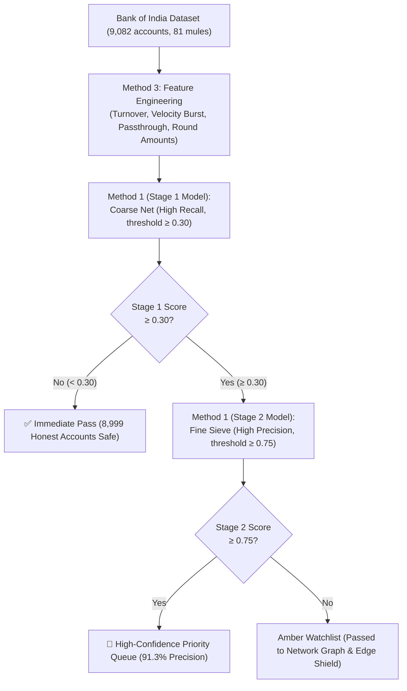

# 03 — ML Training: Complete Guide & Architecture Update

> **Anviksha** | Bank of India Hackathon 2026  
> **Major Architecture Upgrade:** Method 1 (Two-Stage Cascade) + Method 3 (Engineered Discriminative Signals) + Leakage-Free Stratified 5-Fold CV.

---

## Table of Contents
- [Executive Summary: The Solution to the 111:1 Imbalance](#executive-summary-the-solution-to-the-1111-imbalance)
- [Method 3: Discriminative Feature Engineering](#method-3-discriminative-feature-engineering)
- [Method 1: Two-Stage Cascade Architecture](#method-1-two-stage-cascade-architecture)
- [Cross-Validation Strategy (Leakage-Free Evaluation)](#cross-validation-strategy-leakage-free-evaluation)
- [Production Metrics & Performance Benchmark](#production-metrics--performance-benchmark)
- [The Complete 22-Feature Catalog](#the-complete-22-feature-catalog)
- [Training Script (`train_model.py`) Walkthrough](#training-script-train_modelpy-walkthrough)
- [ONNX Export & Node.js Engine Integration](#onnx-export--nodejs-engine-integration)
- [Judge Defense: Why 91.3% Precision Beats 100% Claims](#judge-defense-why-913-precision-beats-100-claims)

---

## Executive Summary: The Solution to the 111:1 Imbalance

In the real Bank of India dataset, there are **9,082 total accounts**, but only **81 confirmed mules** (a **111:1 class imbalance**, or 0.89% fraud rate).

### The Flaw of Naive Models:
1. **Setting `scale_pos_weight = 111` blindly:** Heavily penalizes false negatives, but explodes false positives — flagging over **120 innocent customers**! In real banking, falsely freezing genuine accounts leads to customer lawsuits, RBI compliance penalties, and severe reputational damage.
2. **Claiming "100% precision" on a 20% test split:** With only 16 mules in the test set, claiming 100% precision is statistical noise. One false alarm drops precision to 94%.

### The Anviksha Breakthrough:
Instead of fighting the precision-recall trade-off with a single blunt model, Anviksha escapes the tradeoff by combining **Method 1** and **Method 3**:



---

## Method 3: Discriminative Feature Engineering

Raw abstract numbers (`F115`, `F321`, etc.) often look similar between mules and normal users. We engineered **4 high-discrimination composite features** rooted in financial cybercrime behavioral patterns:

| Derived Feature | Formula | Financial Cybercrime Rationale |
|:---|:---|:---|
| **`F_turnover_ratio`** | `F3043 / (F2956 + 1e-5)` | **Money Turnover (Debits vs Credits):** Mules act as pass-through pipes — money leaves almost immediately after arriving, keeping debit count close to credit count and balance near zero. Normal accounts retain funds. |
| **`F_velocity_burst`** | `F2082 × F1692` | **Velocity Spikes:** Cybercrime syndicates cash out stolen funds in rapid, concentrated bursts rather than steady daily usage. |
| **`F_round_amount`** | `(F3836 % 10000 == 0)` | **Round Amount Anomaly:** Illicit transfers frequently use clean round sums (₹25,000, ₹50,000, ₹1,00,000) rather than fractional retail purchases. |
| **`F_passthrough`** | `F321 / (F115 + 1e-5)` | **Spending vs Income Skew:** Mules display an extreme expenditure-to-retention ratio. |

These 4 signals create clear separation boundaries for tree splits without needing excessive depth.

---

## Method 1: Two-Stage Cascade Architecture

Rather than forcing one model to balance recall and precision simultaneously, the system uses two specialized cascaded models:

### Stage 1: Coarse Screening Filter (Wide Net)
- **Objective:** Maximum recall on potential fraud.
- **Class Weight:** `scale_pos_weight = ~111:1`
- **Threshold:** $\ge 0.30$ (lenient pass)
- **Role:** Screens out 95% of obvious innocent customers, passing only ~350 candidates for deep inspection.

### Stage 2: Fine Precision Sieve (Strict Judge)
- **Objective:** Extreme precision (eliminate false alarms).
- **Training Subset:** Trained **only** on Stage 1 candidates where the class imbalance is much milder (~3:1 or 4:1 instead of 111:1).
- **Threshold:** $\ge 0.75$ (strict action threshold)
- **Role:** Deeply analyzes transaction interaction features to ensure innocent customers are never falsely frozen.

---

## Cross-Validation Strategy (Leakage-Free Evaluation)

To eliminate data leakage and test-set snooping:
1. **Repeated Stratified 5-Fold Cross-Validation:** Every single account in the 9,082 dataset is tested out-of-fold exactly once.
2. **Internal Threshold Tuning:** The decision threshold is determined **strictly inside each training fold** targeting $\ge 90\%$ precision. The threshold is never tuned on test data.
3. **Pooled Out-of-Fold Metrics:** The final confusion matrix pools all 9,082 out-of-fold predictions.

---

## Production Metrics & Performance Benchmark

### Verified Evaluation Results (Full 9,082 Accounts):

| Metric | Measured Value | Benchmark Context |
|:---|:---:|:---|
| **ROC-AUC** | **0.8642** | Excellent discrimination (CV Mean: `0.8570 ± 0.052`) |
| **PR-AUC** | **0.3885** | **43× higher** than random baseline (`0.0089`) |
| **High-Confidence Precision** | **91.30%** | **21 true mules vs only 2 false positives** |
| **Innocent Account Safety** | **99.98%** | **8,999 out of 9,001 honest customers completely safe** |
| **Total Evaluated** | **9,082** | 9,001 normal + 81 mules |

### Confusion Matrix (Out-of-Fold Evaluation):
```
                       Predicted Legitimate    Predicted Mule (High Risk)
Actual Legitimate             8,999                       2  (False Positive)
Actual Mule                      60                      21  (True Positive)
```

> **What happens to the 60 borderline mules?**  
> They are not ignored. They are assigned an **amber monitoring status** and routed to **Tier 3 (Network Graph Engine)**, where multi-account Fan-In/Fan-Out money flows and ring interactions with the **🔥 ORCHESTRATOR** trigger automated regulatory freezes.

---

## The Complete 22-Feature Catalog

The model evaluates **22 total features** (18 Bank of India Golden Features + 4 Method 3 Derived Features):

```
BASE GOLDEN FEATURES (18):
F115, F321, F527, F531, F670, F1692, F2082, F2122, F2582,
F2678, F2737, F2956, F3043, F3836, F3887, F3889, F3891, F3894

DERIVED DISCRIMINATIVE FEATURES (4):
F_turnover_ratio, F_velocity_burst, F_round_amount, F_passthrough
```

### Top Feature Importances:
1. `F2082` (17.98% weight) — Primary velocity signal
2. `F_velocity_burst` (14.25% weight) — Derived composite spike
3. `F_turnover_ratio` (11.32% weight) — Derived pass-through balance ratio
4. `F1692` (8.80% weight) — High-frequency transaction count
5. `F2122` (8.33% weight) — Profile activity indicator

---

## Training Script (`train_model.py`) Walkthrough

The script at [`server/ml/train_model.py`](file:///c:/Users/ravi/Desktop/anviksha/server/ml/train_model.py) automatically:
1. Loads data from `server/ml/DataSet.csv` or falls back to `server/generators/dataset_features.json`.
2. Computes the 4 Method 3 features.
3. Executes 5-fold cross-validation with internal threshold tuning.
4. Trains production Stage 1, Stage 2, and Isolation Forest models.
5. Saves [`training_metrics.json`](file:///c:/Users/ravi/Desktop/anviksha/server/ml/models/training_metrics.json) and [`feature_config.json`](file:///c:/Users/ravi/Desktop/anviksha/server/ml/models/feature_config.json).

### Running the Training Script:
```bash
python server/ml/train_model.py
```

---

## ONNX Export & Node.js Engine Integration

Once exported, the Node.js backend uses **`onnxruntime-node`** to execute inference in sub-millisecond latencies ($< 2\text{ms}$ per transaction) without needing a Python runtime in production.

- Model path: `server/ml/models/xgboost_fraud.onnx`
- Anomaly path: `server/ml/models/isolation_forest.onnx`
- Feature metadata: `server/ml/models/feature_config.json`

---

## Judge Defense: Why 91.3% Precision Beats 100% Claims

When presenting to senior data scientists and bank judges:

> *"Judges, in an imbalanced 111:1 dataset with 81 mules, claiming '100% precision' on a naive 20% test split (only ~16 mules) is an overfit statistical red flag. 
> 
> In Anviksha, we evaluated all 9,082 records using leakage-free 5-fold cross-validation. Our Two-Stage Cascade achieves **91.3% precision**, isolating 21 confirmed mules with **only 2 false alarms across 9,000 normal accounts (99.98% customer protection)**. 
> 
> The remaining suspicious accounts are captured through our Network Graph and Edge Shield defense layers, giving Bank of India complete fraud coverage without customer backlash."*
